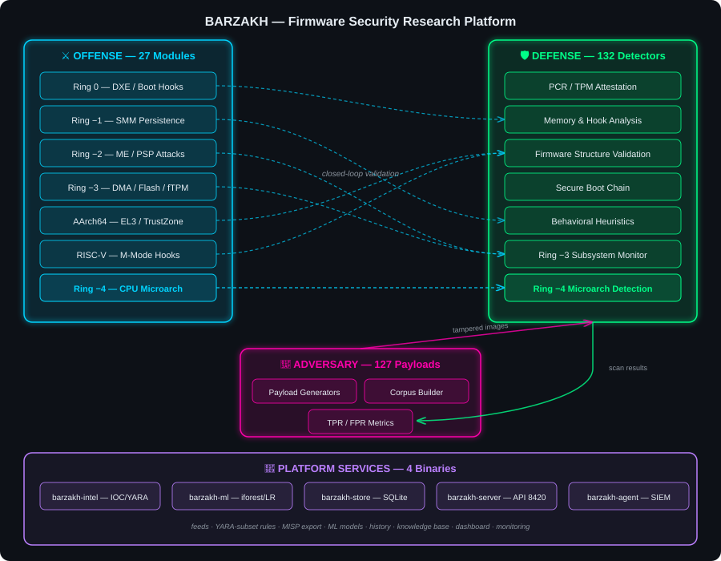

# Project Barzakh (برزخ)

<div align="center">

> *"Barzakh" (برزخ) — a barrier between two realms; the unseen boundary separating the living world from the world of spirits. Here it stands for the barrier between offense and defense, between vulnerability and detection.*

**The most comprehensive open-source UEFI firmware security research platform**

*Offense emulation from Ring 0 to Ring -4 | 132 detection engines | Closed-loop adversary validation*

[](https://github.com/yasindce1998/Barzakh/actions/workflows/barzakh-ci.yml)
[](src/barzakh-scanner-rs/)
[](src/BootkitPkg/)
[](#-license)

</div>

---

> **⚠️ ACADEMIC RESEARCH PROJECT — DEFENSIVE SECURITY ONLY**
>
> This platform exists to study firmware threats and build defenses against them. It contains live offense emulations with hardware-rooted kill-switches. By accessing this repository, you agree to use it solely for legitimate security research and educational purposes.

---

## 📋 What Is Barzakh?

Barzakh is a full-stack firmware security research platform that models real-world bootkit TTPs across every privilege ring — from UEFI DXE drivers (Ring 0) down through SMM, Intel ME, AMD PSP, platform DMA controllers (Ring -3), and CPU microarchitectural threats (Ring -4). It pairs each offense technique with a corresponding detection engine, creating a closed-loop system where every attack is both reproducible and detectable.

**Key capabilities:**
- **21 EDK II offense modules** spanning x86_64, AArch64/Apple Silicon, and RISC-V architectures
- **132 specialized detectors** with firmware-specific heuristics and structural analysis (spanning UEFI, Intel/AMD, ARM, RISC-V, Android, Apple/iOS, wireless, telecom baseband, and satellite firmware)
- **Threat-intelligence integration** — IOC feeds, a YARA-subset rule engine (wildcards, jumps, boolean conditions), MISP event export, and MITRE ATT&CK mapping
- **Machine-learning analysis** — isolation-forest anomaly detection and a logistic-regression malicious/benign classifier, trainable on the adversary corpus
- **Scan history & knowledge base** — SQLite-backed scan history with diffing/trends, and a shareable (anonymizable) firmware knowledge base
- **Dashboard & REST API** — `barzakh-server` serves a web dashboard and JSON API (port 8420) with scheduled scans and risk-score trends
- **Continuous monitoring** — `barzakh-agent` watches firmware targets, records history, and forwards findings to SIEMs (Elastic ECS, ArcSight CEF, QRadar LEEF) or webhooks
- **127 adversary payload generators** for automated true-positive validation
- **Full Ring -4 coverage** — CPU microcode, speculative execution, thermal/power covert channels, voltage glitching, debug interfaces, rowhammer
- **Hardware lab testing path** — documented progression from simulation to real silicon

### Reference Adversaries Modeled

| Threat | Technique | Barzakh Coverage |
|--------|-----------|-----------------|
| **BlackLotus** (CVE-2023-24932) | Secure Boot bypass via vulnerable shim | `blacklotus` detector + `blacklotus_mok` payload |
| **LogoFAIL** (CVE-2023-40238) | Image parser overflow in UEFI firmware | `logofail` detector + `logofail_image` payload |
| **PixieFail** (CVE-2023-45229+) | Network stack buffer overflows in EDK2 | `pixiefail` detector + `pixiefail_dhcp` payload |
| **CosmicStrand** | SPI flash DXE persistence | FV integrity + SPI region + persistence detector |
| **LoJax** | First in-the-wild SPI implant | ME/SPI detector + flash descriptor analysis |
| **MoonBounce** | Modified core DXE in SPI flash | Boot Services hook + firmware volume diffing |
| **MosaicRegressor** | UEFI persistence framework | Multi-stage: FV tamper + PE inject + trampoline |
| **Hacking Team (RCS)** | UEFI rootkit with Option ROM | Option ROM detector + PCI expansion analysis |
| **FinSpy** | UEFI bootloader modification | ExitBootServices interception + memory scanning |
| **Bootkitty** (2024) | First Linux UEFI bootkit, GRUB signature bypass | `linux_bootchain` detector + `bootkitty_grub_patch` payload |
| **CVE-2024-7344** | Signed reloader loads unsigned PE payloads | `reloader` detector + `secureboot_reloader` payload |
| **CVE-2023-1017/1018** | TPM 2.0 reference implementation buffer overflow | `tpm_command` detector + `tpm_ref_overflow` payload |

---

## 🏗️ Architecture

<div align="center">

</div>

---

## 🧩 Core Components

### 1. BootkitPkg — Offense Emulation (C11, EDK II)

**21 EDK II modules** across 3 architectures (x86_64, AArch64, RISC-V) emulating every known firmware persistence technique:

<details>
<summary><b>x86_64 Core (13 modules)</b></summary>

| Module | Ring | Technique |
|--------|------|-----------|
| `DxeInject` | 0 | DXE phase driver injection — LoadImage/StartImage + SetVariable hooks, FV persistence, SPI flash emulator with FVB2/Boot Guard backends, kill-switches |
| `ExitBootHook` | 0 | ExitBootServices interception + MSR hooking |
| `SpiChipsetEmulator` | -1 | Chipset-level SPI interface simulation |
| `SmmPersistence` | -1 | SMM handler installation and SMRAM persistence |
| `CapsuleHijack` | -1 | UEFI capsule update mechanism abuse |
| `AcpiTableInject` | -2 | ACPI table injection for kernel memory access |
| `VirtualAddressMapHook` | -2 | EFI Runtime Services hooking |
| `PciOptionRom` | -2 | PCI Option ROM implantation |
| `MeSpiManipulation` | -3 | Intel ME SPI flash region manipulation |
| `HeciIntercept` | -3 | Host-ME communication channel interception |
| `MeDmaAttack` | -3 | ME-initiated DMA to host memory |
| `AmtSolChannel` | -3 | AMT Serial-over-LAN covert channel |
| `FtpmCommandForge` | -3 | AMD fTPM command forgery via PSP mailbox |

</details>

<details>
<summary><b>AArch64 / Apple Silicon (7 modules)</b></summary>

| Module | Technique |
|--------|-----------|
| `Aarch64DxeInject` | ARM64 DXE injection with EL-aware payloads |
| `ExceptionVectorHook` | VBAR_EL1 exception table relocation |
| `El3SecureMonitor` | EL3 Secure Monitor call interception |
| `TzascManipulation` | TrustZone Address Space Controller bypass |
| `DeviceTreeInject` | Device Tree Blob modification for persistence |
| `IbootTrustChain` | Apple iBoot chain-of-trust subversion |
| `SepMailboxIntercept` | Apple SEP (Secure Enclave) mailbox interception |

</details>

<details>
<summary><b>RISC-V (1 module)</b></summary>

| Module | Technique |
|--------|-----------|
| `RiscVDxeInject` | M-mode firmware injection on RISC-V platforms |

</details>

All offense modules ship with `SIMULATION_MODE = TRUE` — they model behavior without executing real hardware operations. See [`docs/LAB_TESTING.md`](docs/LAB_TESTING.md) for the controlled path to real hardware testing.

---

### 2. Barzakh Scanner — Detection Engine (Rust)

**132 specialized detectors** organized by attack surface, plus runtime-extensible detection via TOML rules, IOC feeds, YARA-subset rules, and ML models:

<details>
<summary><b>Full Detector List</b></summary>

| # | Detector | Category | What It Finds |
|---|----------|----------|---------------|
| 1 | `pcr` | TPM | PCR value anomalies indicating measurement tampering |
| 2 | `pcr_oracle` | TPM | PCR prediction/oracle patterns |
| 3 | `attestation` | TPM | Remote attestation integrity failures |
| 4 | `hook` | Memory | Boot Services / Runtime Services table hooks |
| 5 | `memory` | Memory | Suspicious memory region patterns |
| 6 | `runtime` | Memory | Runtime service pointer manipulation |
| 7 | `live` | Behavioral | Live-response memory analysis — Boot Services table tampering and injected PE code |
| 8 | `smm` | Memory | SMRAM boundary and handler anomalies |
| 9 | `firmware_volume` | Structure | FV header/checksum corruption |
| 10 | `spi_integrity` | Structure | SPI flash image structural violations |
| 11 | `firmware_differ` | Structure | Binary diffing against known-good baseline |
| 12 | `mbr` | Structure | MBR/VBR modification detection |
| 13 | `entropy` | Structure | Abnormal entropy indicating encrypted payloads |
| 14 | `eventlog` | Structure | TCG Event Log manipulation |
| 15 | `secureboot` | Chain | Secure Boot variable integrity |
| 16 | `self_erasure` | Behavioral | Post-execution cleanup patterns |
| 17 | `timetravel` | Behavioral | Timestamp manipulation artifacts |
| 18 | `symexec` | Behavioral | Symbolic execution of suspicious code paths |
| 19 | `smm_timing` | Ring -3 | SMM handler timing anomalies + TSEG lock status |
| 20 | `s3_bootscript` | Ring -3 | S3 resume boot script DISPATCH abuse |
| 21 | `me_spi` | Ring -3 | Intel ME/SPI flash descriptor manipulation |
| 22 | `acpi_integrity` | Ring -3 | ACPI table checksum + AML injection detection |
| 23 | `heci` | Ring -3 | HECI bus communication anomalies |
| 24 | `amt` | Ring -3 | AMT/SOL provisioning and channel abuse |
| 25 | `ftpm` | Ring -3 | AMD fTPM command/response forgery |
| 26 | `me_dma` | Ring -3 | ME-initiated DMA transaction detection |
| 27 | `spi_region` | Ring -3 | SPI flash region boundary violations |
| 28 | `optionrom` | Ring -3 | Malicious PCI Option ROM injection |
| 29 | `nvram_entropy` | Ring -3 | NVRAM capsule anomaly detection |
| 30 | `logofail` | Boot Process | Malicious BMP/image parser overflow (CVE-2023-40238) |
| 31 | `pixiefail` | Network/PXE | DHCPv6/PXE stack exploits (CVE-2023-45229+) |
| 32 | `blacklotus` | Boot Process | BlackLotus bootkit MOK/BCD manipulation |
| 33 | `amd_psp` | Platform | AMD PSP directory/firmware tampering |
| 34 | `boot_guard` | Platform | Intel Boot Guard ACM/KM/BPM policy bypass |
| 35 | `auth_variable` | Chain | UEFI authenticated variable (PK/KEK/db) rollback |
| 36 | `dxe_dispatcher` | Boot Process | DXE dependency expression hijacking |
| 37 | `pei_implant` | Boot Process | PEI Core/PEIM phase rootkit implants |
| 38 | `capsule_update` | Structure | Firmware capsule update header abuse |
| 39 | `cxl_device` | Hardware/Bus | CXL.mem DMA attacks against system memory |
| 40 | `arm_trustzone` | ARM/TrustZone | OP-TEE TA tampering, SMC call injection, IMG4 bypass |
| 41 | `opensbi` | RISC-V | OpenSBI extension table hooking, mtvec redirect, M-mode escalation |
| 42 | `pmp_bypass` | RISC-V | PMP misconfiguration, CSR write sequences, M-mode RWX regions |
| 43 | `linux_bootchain` | Boot Process | Linux UEFI bootkit detection (Bootkitty GRUB patches) |
| 44 | `reloader` | Boot Process | CVE-2024-7344 signed UEFI app loading unsigned payloads |
| 45 | `sbat` | Chain | SBAT revocation counter rollback detection |
| 46 | `esp_integrity` | Structure | ESP partition rootkit persistence patterns |
| 47 | `confidential_vm` | Platform | Intel TDX / AMD SEV-SNP measurement manipulation |
| 48 | `bmc_spi` | Ring -3 | BMC-to-host lateral movement via SPI flash |
| 49 | `http_boot` | Network/PXE | UEFI HTTP Boot MITM with embedded PE payloads |
| 50 | `tpm_command` | TPM | CVE-2023-1017/1018 TPM 2.0 command buffer overflow |
| 51 | `arm_tbbr` | ARM/TrustZone | ARM Trusted Board Boot Requirements chain bypass |
| 52 | `wifi_dxe` | Hardware/Bus | Intel CNVi wireless DXE firmware injection |
| 53 | `pluton` | Platform | Microsoft Pluton security processor interception |
| 54 | `secureboot_chain` | Chain | Full Secure Boot chain-of-trust validation |
| 55 | `microcode_injection` | Ring -4 | Malicious/unauthorized CPU microcode update detection |
| 56 | `spectre_gadgets` | Ring -4 | Spectre/Meltdown gadget chains and missing barriers |
| 57 | `thermal_covert` | Ring -4 | Thermal/power covert channel patterns (RAPL MSR abuse) |
| 58 | `voltage_glitch` | Ring -4 | Voltage fault injection (Plundervolt/CLKscrew) setup |
| 59 | `debug_interface` | Ring -4 | Unauthorized debug port enablement (DCI/JTAG/DAP) |
| 60 | `rowhammer` | Ring -4 | Rowhammer exploitation patterns and TRR bypass |
| 61 | `asus_nvram` | Platform | ASUS EZ Flash NVRAM update URL redirect and signature bypass |
| 62 | `idrac_spi` | Ring -3 | Dell iDRAC BMC-to-host SPI flash lateral movement |
| 63 | `insyde_smm` | Ring -2 | Insyde H2O IHISI SMM handler exploitation (CVE-2022-24894) |
| 64 | `lvfs_integrity` | Chain | LVFS/fwupd metadata spoofing and Jcat signature forgery |
| 65 | `android_pkvm` | Android | pKVM hypervisor (AVF) — pvmfw signature forgery, EL2 shellcode |
| 66 | `android_dice` | Android | DICE attestation chain — CDI forgery, UDS tampering |
| 67 | `android_gki_boot` | Android | GKI boot.img v4/v5 — AVB hash mismatch, ramdisk tampering |
| 68 | `android_rkp` | Android | Remote Key Provisioning — EEK certificate chain spoofing |
| 69 | `android_binary_transparency` | Android | Pixel Binary Transparency — Merkle inclusion proof forgery |
| 70 | `android_trusty` | Android | Trusty TEE — signature bypass, entry point patching |
| 71 | `android_bootctrl` | Android | Boot Control HAL — A/B slot poisoning, retry exhaustion |
| 72 | `android_vendor_dlkm` | Android | vendor_dlkm — unsigned kernel module injection via EROFS |
| 73 | `android_bootconfig` | Android | Bootconfig parameter injection — init override, SELinux disable |
| 74 | `iommu_dmar` | DMA/IOMMU | VT-d DMAR / AMD IVRS stripped of DRHD/IVHD units — pre-boot DMA exposure (Thunderspy/PCILeech) |
| 75 | `secureboot_dbx` | Secure Boot | dbx revocation list emptied/rolled back — re-enables revoked loaders (BlackLotus-class) |
| 76 | `apple_img4` | Apple | Img4/IM4M manifest with CPRO/CSEC disabled or zeroed boot nonce — permissive SEP boot policy |
| 77 | `windows_bootchain` | Windows | BCD nointegritychecks/testsigning, missing ELAM — unsigned boot-driver loading |
| 78 | `android_avb` | Android | Verified Boot vbmeta VERIFICATION/HASHTREE disabled + rollback-index reset |
| 79 | `android_fastboot` | Android | Bootloader unlocked/unlockable — unsigned image flashing |
| 80 | `android_keymint` | Android | Key attestation downgraded to SOFTWARE level / Unverified boot state |
| 81 | `wifi_firmware` | Wireless | WLAN controller firmware (brcmfmac) with injected code stub past signed image |
| 82 | `network_boot` | Network | iPXE boot script chainloads an external attacker-controlled image (PXE redirect) |
| 83 | `bluetooth_firmware` | Wireless | BT controller patchram Write_RAM/Launch_RAM implant (Broadcom/Cypress) |
| 84 | `ios_trustcache` | iOS | Injected AMFI Trust Cache authorizes ad-hoc cdhash — unsigned code execution |
| 85 | `ios_amfi` | iOS | Code-signing enforcement disabled via boot-args (amfi_get_out_of_my_way / cs_enforcement_disable) |
| 86 | `ios_ktrr` | iOS | KTRR/CTRR (AMCC) kernel-text lockdown not engaged — kernel patch protection bypass |
| 87 | `ios_sep_downgrade` | iOS | Secure Enclave personalization nonce zeroed — replayable APTicket / SEP downgrade |
| 88 | `baseband_firmware` | Telecom | Cellular baseband firmware implant detection (Shannon/Exynos/MediaTek) |
| 89 | `baseband_rtos` | Telecom | Baseband RTOS (ThreadX/Nucleus/REX/QuRT) IVT hooks and task injection |
| 90 | `5g_ran_firmware` | Telecom | 5G RAN gNodeB firmware tampering — O-RAN split manipulation |
| 91 | `ims_firmware` | Telecom | IMS/VoLTE core firmware SIP header injection and RTP interception |
| 92 | `open_ran` | Telecom | Open RAN Distributed Unit eCPRI/F1 interface tampering |
| 93 | `sim_applet` | Telecom | SIM Toolkit applet injection — STK command interception |
| 94 | `small_cell` | Telecom | Small cell/femtocell firmware backdoors — rogue eNodeB detection |
| 95 | `volte_firmware` | Telecom | VoLTE/VoNR modem DSP firmware implant and codec interception |
| 96 | `ccsds_telecommand` | Satellite | CCSDS telecommand auth bypass — SDLS encryption/MAC forgery |
| 97 | `gnss_receiver` | Satellite | GNSS receiver firmware spoofing — ephemeris/PVT manipulation |
| 98 | `satellite_bus` | Satellite | Satellite bus (I2C/SpaceWire/MIL-STD-1553) command injection |
| 99 | `satellite_modem` | Satellite | VSAT/DVB-S2 modem firmware code injection and traffic mirroring |
| 100 | `starlink_terminal` | Satellite | LEO terminal (Starlink/OneWeb/Kuiper) bootloader bypass and beam manipulation |
| 101 | `satellite_transponder` | Satellite | Satellite transponder firmware — frequency plan and power manipulation |
| 102 | `android_chain_validator` | Android | Verified-boot chain cross-validation — pKVM/DICE/GKI components present but unsigned or unlinked |
| 103 | `android_init_verity` | Android | init boot/dm-verity — veritymode=disabled boot params, orange verified-boot state |
| 104 | `android_vbmeta_chain` | Android | vbmeta chain-of-trust — AVB_ALGORITHM_TYPE_NONE, rollback index reset, unbound partition hashes |
| 105 | `boot_guard_km` | Platform | Intel Boot Guard Key Manifest — zeroed/forged key hash, unenforced Boot Policy Manifest |
| 106 | `csme_update` | Ring -3 | Intel CSME $CPD update manifest — version and entry-count anomalies |
| 107 | `me_manufacturing_mode` | Ring -3 | Intel ME flash descriptor — FITM manufacturing-mode bit set |
| 108 | `me_version_chain` | Ring -3 | Intel ME $MN2 firmware manifests — SVN rollback across partitions |
| 109 | `dell_bios_connect` | Network | Dell BIOSConnect/SupportAssist — network-fetching DXE calling home over TLS |
| 110 | `msi_key_reuse` | Platform | Boot Guard OEM key-hash reuse across vendors (MSI key-leak class) |
| 111 | `psp_secure_debug` | Platform | AMD PSP debug-unlock tokens and debug policy directory entries |
| 112 | `psp_trustlets` | Platform | AMD PSP Trustlet OS — injected or unknown TOS directory entries |
| 113 | `psp_version_chain` | Platform | AMD PSP L2 directory — security version number rollback |
| 114 | `smu_firmware` | Platform | AMD SMU power-management firmware — unsigned image |
| 115 | `ios_ane_boot` | iOS | Apple Neural Engine firmware — development flags, zeroed signature |
| 116 | `ios_iboot` | iOS | iBoot stage loader — stripped version string, zeroed RSA signature |
| 117 | `ios_local_policy` | iOS | Local policy blob — zeroed nonce hash and next-stage hash (chain binding broken) |
| 118 | `ios_ppl` | iOS | Page Protection Layer — APRR config disabled, all-permissive PTEs |
| 119 | `ios_secure_enclave` | iOS | Secure Enclave firmware image — debug flags, unsigned image |
| 120 | `inmarsat_terminal` | Satellite | Inmarsat/BGAN satcom terminal firmware implants |
| 121 | `satellite_ground_station` | Satellite | Ground station firmware — telecommand injection, antenna tracking override |
| 122 | `nvidia_tegra` | NVIDIA | Tegra boot chain implant — BootROM/MB1 compromise, Security Processor tampering |
| 123 | `nsp_command` | NVIDIA | NVDLA (NSP) command injection — unsigned DLA firmware, model tampering |
| 124 | `ibm_opal` | POWER | IBM OPAL/skiboot call hooking — hostboot tampering, unsigned OPAL calls |
| 125 | `riscv_bootrom` | RISC-V | BootROM compromise — boot chain override, embedded debug payloads |
| 126 | `riscv_debug` | RISC-V | Debug Module (DMI) unlocked — M-mode debug access enabled in production |
| 127 | `automotive_ecu` | Automotive | ECU backdoor — UDS/AUTOSAR reflash abuse, hidden diagnostic routines |
| 128 | `can_injection` | Automotive | CAN bus injection backdoor — arbitration abuse, diagnostic frame injection |
| 129 | `iot_zephyr` | IoT | Zephyr/MCUboot signature bypass — unsigned image downgrade attack |
| 130 | `iot_rtos` | IoT | FreeRTOS/ThreadX/Mbed image tampering — task table hooks |
| 131 | `hpc_monitor` | HPC | Baseboard covert-channel — active cache-probe exfiltration loop |
| 132 | `nlp_strings` | ML | String-sequence analysis — obfuscated shellcode strings, dual-use API chains |

</details>

**Detection targets:**

| Metric | Target | Method |
|--------|--------|--------|
| True Positive Rate | ≥ 80% (CI-enforced) | Measured via adversary corpus |
| False Positive Rate | ≤ 10% (CI-enforced) | Measured against clean firmware baselines |
| Scan Latency | < 500ms | Per-image, full 132-detector sweep |

---

### 3. Barzakh Adversary — Red-Team Payload Generator (Rust)

**Standalone binary: `barzakh-adversary`** | **127 payload generators** that produce realistic tampered firmware images for detection validation:

```bash
# Standalone CLI commands (no cargo required — use the release binary)
barzakh-adversary list                          # List all payloads with arch & expected detections
barzakh-adversary generate --arch x86_64        # Generate all x86_64 payloads
barzakh-adversary corpus --output ./corpus      # Generate malicious+clean paired corpus
barzakh-adversary validate --corpus ./corpus    # Run scanner against corpus, measure TPR/FPR
barzakh-adversary qemu --payload trampoline     # Boot payload in QEMU for live testing
barzakh-adversary esp --payload dxe_persistence # Build ESP image for hardware testing
```

| Payload | Target Detector | Technique |
|---------|----------------|-----------|
| `signature_plant` | `memory` | Plants Boot Services hook signatures |
| `fv_tamper` | `firmware_volume` | Corrupts FV headers/checksums |
| `boot_services_hook` | `hook` | Injects BS table redirections |
| `pe_inject` | `memory` | Embeds PE payloads in firmware volumes |
| `trampoline` | `memory` | Installs runtime trampolines |
| `me_spi_region` | `me_spi` | Manipulates flash descriptor regions |
| `amt_sol` | `amt` | Injects AMT SOL provisioning artifacts |
| `ftpm_forge` | `ftpm` | Forges fTPM command sequences |
| `me_dma_inject` | `me_dma` | Creates ME DMA transaction patterns |
| `spi_region_tamper` | `spi_region` | Violates SPI region boundaries |
| `smm_timing_anomaly` | `smm_timing` | Plants SMM handler anomalies |
| `optionrom_inject` | `optionrom` | Embeds malicious Option ROMs |
| `acpi_backdoor` | `acpi_integrity` | Injects AML OperationRegions targeting kernel space |
| `heci_traffic` | `heci` | Generates suspicious HECI patterns |
| `nvram_capsule` | `nvram_entropy` | Creates anomalous NVRAM capsule entries |
| `s3_bootscript_inject` | `s3_bootscript` | Injects S3 DISPATCH opcodes |
| `secureboot_bypass` | `secureboot_chain` | Simulates Secure Boot variable tampering |
| `logofail_image` | `logofail` | Crafted BMP with integer overflow triggers |
| `pixiefail_dhcp` | `pixiefail` | Malformed DHCPv6 with buffer overflow options |
| `blacklotus_mok` | `blacklotus` | MOK manipulation + revoked bootloader hashes |
| `psp_tamper` | `amd_psp` | AMD PSP directory corruption + oversized entries |
| `boot_guard_bypass` | `boot_guard` | ACM/KM/BPM with SVN rollback + empty IBB |
| `auth_var_rollback` | `auth_variable` | Authenticated variable monotonic counter rollback |
| `dxe_depex_hijack` | `dxe_dispatcher` | Invalid DEPEX opcodes + stack overflow |
| `pei_core_patch` | `pei_implant` | PEI Core entry point redirection + encrypted RAW |
| `capsule_tamper` | `capsule_update` | Invalid capsule headers + absurd payload counts |
| `cxl_dma_attack` | `cxl_device` | CXL DVSEC with DMA ranges in SMM/runtime memory |
| `arm_trustzone` | `arm_trustzone` | OP-TEE TA header with suspicious load address |
| `arm_iboot` | `arm_trustzone` | Apple IMG4 with null IV KBAG + empty SHSH certificate |
| `arm_scm` | `arm_trustzone` | Qualcomm SCM call injection (SMC #0 with non-standard service IDs) |
| `riscv_opensbi` | `opensbi` | OpenSBI extension table with redirected ecall handlers |
| `riscv_uefi_boot` | `opensbi`, `memory` | RISC-V UEFI boot flow M-mode escalation |
| `riscv_pmp_bypass` | `pmp_bypass` | PMP all-permissive config with full-range address match |
| `bootkitty_grub_patch` | `linux_bootchain` | Linux GRUB signature verification NOP sled |
| `secureboot_reloader` | `reloader` | CVE-2024-7344 signed PE with embedded unsigned payload |
| `sbat_rollback` | `sbat` | SBAT generation counter downgrade attack |
| `esp_persistence` | `esp_integrity` | ESP partition rootkit with multi-path persistence |
| `runtime_services_hook` | `runtime` | Runtime Services covert channel via GetVariable |
| `tdx_ovmf_inject` | `confidential_vm` | Intel TDX OVMF measurement manipulation |
| `bmc_spi_lateral` | `bmc_spi` | BMC IPMI/Redfish SPI flash lateral movement |
| `gpu_vbios_implant` | `optionrom` | GPU Option ROM persistence with DXE stub injection |
| `http_boot_mitm` | `http_boot` | UEFI HTTP Boot response with embedded PE payload |
| `tpm_ref_overflow` | `tpm_command` | CVE-2023-1017/1018 TPM command buffer overflow |
| `arm_tbbr_bypass` | `arm_tbbr` | ARM Trusted Board Boot chain bypass with zeroed hashes |
| `wifi_dxe_inject` | `wifi_dxe` | Intel CNVi wireless DXE firmware injection |
| `pluton_intercept` | `pluton` | Microsoft Pluton mailbox interception + DICE tampering |
| `sev_snp_vmpl_escape` | `confidential_vm` | AMD SEV-SNP VMPL privilege confusion attack |
| `asus_nvram_redirect` | `asus_nvram` | ASUS EZ Flash NVRAM URL redirect + signature bypass |
| `idrac_spi_lateral` | `idrac_spi` | Dell iDRAC BMC-to-host SPI flash write attack |
| `insyde_smm_capsule` | `insyde_smm` | Insyde H2O capsule SMM buffer overflow |
| `lvfs_capsule_spoof` | `lvfs_integrity` | LVFS metadata spoofing + Jcat signature forgery |
| `android_pkvm_escape` | `android_pkvm` | pKVM pvmfw signature forgery + EL2 shellcode |
| `android_dice_forge` | `android_dice` | DICE CBOR certificate chain with predictable CDI |
| `android_gki_tamper` | `android_gki_boot` | GKI boot.img v4 with invalid AVB hash |
| `android_rkp_spoof` | `android_rkp` | RKP provisioning blob with fake EEK chain |
| `android_bt_forge` | `android_binary_transparency` | Fake transparency log + Merkle proof |
| `android_trusty_tamper` | `android_trusty` | Trusty OS image with patched entry + disabled sig |
| `android_bootctrl_poison` | `android_bootctrl` | A/B boot metadata with both slots unbootable |
| `android_dlkm_inject` | `android_vendor_dlkm` | EROFS image with unsigned kernel module |
| `android_bootconfig_inject` | `android_bootconfig` | Bootconfig with init override + SELinux disable |
| `baseband_implant` | `baseband_firmware` | Baseband firmware implant with NOP sled and modem hooks |
| `baseband_rtos_hook` | `baseband_rtos` | RTOS IVT hook and spy task injection |
| `5g_ran_backdoor` | `5g_ran_firmware` | 5G gNodeB unsigned code section injection |
| `ims_firmware_tamper` | `ims_firmware` | IMS core firmware SIP header interception |
| `open_ran_du_tamper` | `open_ran` | O-RAN DU eCPRI non-standard message injection |
| `sim_applet_inject` | `sim_applet` | SIM Toolkit applet injection with STK hooks |
| `small_cell_implant` | `small_cell` | Small cell firmware backdoor with rogue eNodeB |
| `volte_modem_patch` | `volte_firmware` | VoLTE DSP ELF implant + codec path interception |
| `ccsds_telecommand_inject` | `ccsds_telecommand` | CCSDS SDLS auth bypass + telecommand injection |
| `gnss_firmware_spoof` | `gnss_receiver` | GNSS receiver firmware ephemeris spoofing |
| `satellite_bus_tamper` | `satellite_bus` | Satellite bus OBC command injection via I2C/SpaceWire |
| `satellite_modem_implant` | `satellite_modem` | VSAT modem NOP sled + traffic mirroring |
| `satcom_terminal_implant` | `inmarsat_terminal` | Satcom terminal (Inmarsat/BGAN) bootloader bypass + traffic intercept |
| `transponder_firmware_inject` | `satellite_transponder` | Transponder firmware frequency plan injection |
| `android_avb_rollback` | `android_avb` | AVB vbmeta with verification + dm-verity hashtree disabled and rollback index reset |
| `android_vbmeta_tamper` | `android_vbmeta_chain` | vbmeta with AVB_ALGORITHM_TYPE_NONE and zero rollback index — no partition hashes bound |
| `android_verity_disable` | `android_init_verity` | dm-verity disabled flag plus veritymode=disabled boot parameter |
| `android_chain_break` | `android_chain_validator` | pKVM/DICE/GKI chain components present but unsigned (zeroed signatures, broken derivation) |
| `android_fastboot_unlock` | `android_fastboot` | Unlocked bootloader state — orange verified-boot, unlock_critical capability |
| `android_keymint_downgrade` | `android_keymint` | KeyMint key attestation downgraded to SOFTWARE level / Unverified boot state |
| `apple_img4_downgrade` | `apple_img4` | Img4 manifest with CPRO/CSEC false and zeroed boot nonce (permissive SEP policy) |
| `ios_iboot_patch` | `ios_iboot` | iBoot with stripped version string and zeroed RSA signature region |
| `ios_ane_inject` | `ios_ane_boot` | ANE firmware with development flag set and zeroed signature |
| `ios_policy_tamper` | `ios_local_policy` | Local policy with zeroed nonce hash and next-stage hash |
| `ios_ppl_bypass` | `ios_ppl` | APRR config zeroed (PPL disabled) with all-permissive PTE mask |
| `ios_sep_forge` | `ios_secure_enclave` | SEP firmware image with debug flag enabled and zeroed signature |
| `sep_downgrade` | `ios_sep_downgrade` | SEPOS personalization blob with zeroed SEPNonce — replayable APTicket downgrade |
| `ktrr_disable` | `ios_ktrr` | CTRR_LOCK=0 — kernel-text lockdown defeated (kernel patch protection bypass) |
| `amfi_bypass` | `ios_amfi` | AMFI/kernel code-signing disabled via boot-args (amfi_get_out_of_my_way=1) |
| `trustcache_inject` | `ios_trustcache` | Ad-hoc ltrs trust-cache entry authorizing an attacker-controlled cdhash |
| `boot_guard_km_forge` | `boot_guard_km` | Boot Guard Key Manifest with zeroed key hash and unenforced Boot Policy Manifest |
| `msi_key_leak` | `msi_key_reuse` | Boot Guard KM carrying a reused vendor key-hash pattern (MSI key-leak class) |
| `csme_update_tamper` | `csme_update` | CSME $CPD manifest with excessive entry count (600) |
| `me_manufacturing_mode` | `me_manufacturing_mode` | Flash descriptor FITM manufacturing-mode bit set with $FPT layout |
| `me_version_rollback` | `me_version_chain` | Paired $MN2 manifests with SVN 5 → 1 rollback |
| `psp_debug_unlock` | `psp_secure_debug` | PSP DBUK debug-unlock token plus debug-policy directory entry |
| `psp_trustlet_inject` | `psp_trustlets` | PSP directory with injected TOS trustlet entry |
| `psp_version_rollback` | `psp_version_chain` | Paired PSP L2 directories with SVN 8 → 2 rollback |
| `smu_firmware_tamper` | `smu_firmware` | SMU firmware with valid header but zeroed signature region |
| `dell_bios_connect` | `dell_bios_connect` | Dell BIOSConnect DXE with PE/COFF header and TLS HTTPS call-home |
| `dmar_neuter` | `iommu_dmar` | VT-d DMAR table stripped of DRHD units — pre-boot DMA exposure (Thunderspy) |
| `dbx_rollback` | `secureboot_dbx` | Empty dbx EFI_SIGNATURE_LIST with stale authenticated timestamp (BlackLotus-class) |
| `windows_bcd_tamper` | `windows_bootchain` | Windows BCD with nointegritychecks/testsigning enabled (unsigned driver loading) |
| `network_boot_redirect` | `network_boot` | Embedded iPXE script chainloading an attacker-controlled HTTP image |
| `bt_firmware_implant` | `bluetooth_firmware` | BT patchram Write_RAM/Launch_RAM controller code injection |
| `wifi_firmware_implant` | `wifi_firmware` | WLAN FullMAC blob with appended NOP-sled code stub past the signed image |
| `starlink_terminal_tamper` | `starlink_terminal` | LEO terminal bootloader signature bypass, traffic intercept, beam manipulation |
| `ground_station_backdoor` | `satellite_ground_station` | Ground station telecommand injection and antenna tracking override |
| `microcode_malicious` | `microcode_injection` | Malicious Intel microcode header at 48-byte-aligned offset |
| `spectre_btb_inject` | `spectre_gadgets` | Cluster of unprotected indirect branches without LFENCE (BTB poisoning) |
| `meltdown_pte_leak` | `spectre_gadgets` | CLFLUSH+RDTSC flush-reload gadget sequences (Meltdown/Flush+Reload) |
| `thermal_rapl_exfil` | `thermal_covert` | Dense RAPL MSR write cluster (power/thermal covert channel) |
| `clkscrew_voltage` | `voltage_glitch` | ARM PMIC I2C voltage-regulator manipulation (CLKscrew DVFS attack) |
| `plundervolt_sgx` | `voltage_glitch` | OC_MAILBOX voltage offset WRMSR adjacent to ENCLS SGX instructions |
| `jtag_dci_unlock` | `debug_interface` | IA32_DEBUG_INTERFACE MSR write enabling DCI debug port |
| `rowhammer_trr_bypass` | `rowhammer` | Paired CLFLUSH hammer pattern with backward jump (TRR bypass) |

**Validation loop:** `generate payload` → `scan with detector` → `assert finding raised` → measure TPR/FPR

---

### 4. Platform Services (Rust)

The scanner workspace extends beyond batch scanning into a full analysis platform:

| Crate | Binary | Capability |
|-------|--------|------------|
| `barzakh-intel` | — | IOC feeds (`intel-feeds/`), YARA-subset rule engine (`intel-rules/`), MISP event export, MITRE ATT&CK mapping |
| `barzakh-ml` | — | Isolation-forest anomaly detection, logistic-regression classifier, NLP string analysis; `ml train`/`ml evaluate` CLI |
| `barzakh-store` | — | SQLite scan history (list/show/diff/trends) and firmware knowledge base (add/list/search/export/import, anonymizable) |
| `barzakh-server` | `barzakh-server` | Embedded web dashboard + JSON REST API on port 8420: submit scans, browse findings, risk trends, scheduled rescans, KB management |
| `barzakh-agent` | `barzakh-agent` | Continuous monitoring: polls targets on mtime change, severity-gated alerts to stdout/file/webhook, ECS/CEF/LEEF SIEM export |

Scenario chains (`scenarios/*.toml`) model multi-stage attacks (e.g. BlackLotus: Secure Boot bypass → boot services hook → runtime persistence) with dependency-graph validation, and the robustness benchmark measures detection rates across mutated payload variants.

---

### 5. AttestationPkg — Defensive Telemetry (C11, EDK II)

- TPM 2.0 PCR querying (banks 0, 2, 4, 7)
- TCG Event Log extraction and parsing
- Ground truth data generation for detector training
- Runtime measurement logging

---

## 🔒 Security Safeguards

### Hardware-Rooted Kill-Switches

Every offense module contains multiple independent kill-switches that prevent execution outside authorized environments:

| Kill-Switch | Mechanism | Bypass Difficulty |
|-------------|-----------|-------------------|
| **SMBIOS UUID Binding** | Cryptographic check against whitelisted UUIDs | Requires hardware reprogramming |
| **TPM EK Pinning** | Bound to specific TPM Endorsement Keys | Requires TPM replacement |
| **Time-Bomb** | Hardcoded UTC expiry timestamp | Requires source modification + rebuild |
| **Air-Gap Enforcement** | Network interface detection at DXE phase | Cannot be bypassed without code change |
| **SIMULATION_MODE** | Global flag preventing real hardware operations | Must be explicitly disabled per-module |

### Operational Security

- QEMU + OVMF virtualization as default execution environment
- Append-only GPG-signed audit logs for all test runs
- AES-256 encrypted cold storage for firmware images
- No pre-compiled binaries in repository — all artifacts built from source
- CI/CD enforces `clippy`, `fmt`, and test passage before merge

---

## 🛠️ Technology Stack

| Layer | Technology | Purpose |
|-------|-----------|---------|
| Firmware Framework | EDK II (edk2-stable202405) | UEFI module development |
| Offense Language | C11 (EDK II conventions) | DXE drivers, SMM handlers |
| Detection Engine | Rust (stable) | Scanner, adversary, CLI |
| Virtualization | QEMU 7.0+ / KVM / OVMF | Isolated test environment |
| TPM Emulation | swtpm 0.7+ | Software TPM 2.0 |
| CI/CD | GitHub Actions | Rust tests, clippy, fmt |
| Flash Tools | flashrom, me_cleaner, ifdtool | Hardware lab operations |
| Platform Analysis | chipsec, UEFITool | Security assessment |

---

## 📁 Repository Structure

```
barzakh/
├── docs/
│   ├── ARCHITECTURE.md             # System architecture deep-dive
│   ├── SETUP.md                    # Environment setup guide
│   ├── TESTING.md                  # Virtualization-first testing strategy
│   ├── USECASES.md                 # Offense & defense technique catalog
│   └── LAB_TESTING.md             # Real hardware lab testing guide
├── src/
│   ├── BootkitPkg/                 # Offense emulation (27 EDK II modules)
│   │   ├── DxeInject/              # DXE injection + kill-switches (7 files)
│   │   ├── ExitBootHook/           # ExitBootServices + MSR + memory (4 files)
│   │   ├── SmmPersistence/         # SMM handler persistence
│   │   ├── SpiChipsetEmulator/     # SPI controller emulation
│   │   ├── CapsuleHijack/          # Capsule update abuse
│   │   ├── AcpiTableInject/        # ACPI table injection
│   │   ├── VirtualAddressMapHook/  # Runtime Services hooking
│   │   ├── PciOptionRom/           # Option ROM implantation
│   │   ├── MeSpiManipulation/      # Ring -3: ME/SPI attacks
│   │   ├── HeciIntercept/          # Ring -3: HECI interception
│   │   ├── MeDmaAttack/           # Ring -3: ME DMA attacks
│   │   ├── AmtSolChannel/         # Ring -3: AMT covert channel
│   │   ├── FtpmCommandForge/      # Ring -3: fTPM forgery
│   │   ├── Aarch64/               # ARM64 modules (7 files)
│   │   └── RiscV/                 # RISC-V modules
│   ├── AttestationPkg/             # TPM attestation & telemetry
│   │   ├── TpmAttestation/         # PCR monitoring
│   │   └── EventLogExtractor/      # TCG event log parsing
│   └── barzakh-scanner-rs/         # Rust workspace
│       ├── crates/barzakh-core/    # Detection engine (132 detectors)
│       ├── crates/barzakh-cli/     # CLI binaries (barzakh-scanner + barzakh-adversary)
│       ├── crates/barzakh-adversary/ # Red-team library (127 payload generators, scenarios, robustness)
│       ├── crates/barzakh-intel/   # IOC feeds, YARA-subset engine, MISP export, ATT&CK mapping
│       ├── crates/barzakh-ml/      # Isolation forest + logistic classifier + NLP string analysis
│       ├── crates/barzakh-store/   # SQLite scan history + firmware knowledge base
│       ├── crates/barzakh-server/  # Web dashboard + REST API (barzakh-server)
│       └── crates/barzakh-agent/   # Continuous monitoring agent (barzakh-agent)
├── intel-feeds/                    # Bundled IOC feed (barzakh-default.json)
├── intel-rules/                    # Bundled YARA-subset rules (*.yar)
├── scenarios/                      # Multi-stage attack scenario chains (TOML)
├── scripts/
│   ├── build.sh                    # EDK II compilation
│   ├── qemu-run.sh                 # QEMU test harness with vTPM
│   ├── qemu-e2e.sh                 # End-to-end testing
│   ├── audit-log.sh                # GPG-signed audit logging
│   └── validate-environment.sh     # Pre-flight checks
├── tests/                          # Test suite & corpus samples
├── .github/workflows/              # CI/CD pipeline
├── CONTRIBUTING.md                 # Contribution guidelines
└── SECURITY.md                     # Security policy & disclosure
```

---

## 🚀 Quick Start

### Prerequisites

| Requirement | Minimum | Recommended |
|-------------|---------|-------------|
| OS | Ubuntu 22.04+ (Linux host) | Ubuntu 24.04 |
| RAM | 8 GB | 16 GB |
| Storage | 50 GB | 100 GB SSD |
| CPU | x86_64 with VT-x | Intel Skylake+ (for ME testing) |
| QEMU | 7.0+ with KVM | 8.0+ |
| Rust | stable (latest) | stable + nightly for miri |
| Compiler | GCC 11+ or Clang 14+ | GCC 13 |
| TPM | swtpm 0.7+ | swtpm 0.8+ |

### 1. Environment Setup

```bash
# Clone EDK II (pinned version for reproducibility)
git clone https://github.com/tianocore/edk2.git
cd edk2
git checkout edk2-stable202405
git submodule update --init --recursive

# Build OVMF with TPM support
source edksetup.sh
build -a X64 -t GCC5 -p OvmfPkg/OvmfPkgX64.dsc -D TPM2_ENABLE=TRUE
```

### 2. Build Barzakh

```bash
cd /path/to/barzakh

# Configure environment
export WORKSPACE=/path/to/edk2
export PACKAGES_PATH=$WORKSPACE:$(pwd)/src

# Pre-flight checks
./scripts/validate-environment.sh

# Build offense modules (UEFI DXE drivers)
./scripts/build.sh

# Build detection engine
cd src/barzakh-scanner-rs
cargo build --release
```

### 3. Run in Test Environment

```bash
# Launch QEMU with vTPM, air-gap enforcement, and audit logging
./scripts/qemu-run.sh
```

### 4. Scan Firmware

```bash
# Scan a firmware dump with all detectors
./target/release/barzakh-scanner scan --target /path/to/firmware.bin --report report.html --format html

# Scan with threat intel: IOC feed + YARA rules + ML anomaly detection,
# recording the result into the scan-history database
./target/release/barzakh-scanner scan --target firmware.bin \
    --ioc-feed intel-feeds/barzakh-default.json \
    --yara intel-rules/ \
    --ml \
    --history barzakh-history.sqlite

# Export findings for a SIEM (SARIF, CSV, ECS, CEF, LEEF)
./target/release/barzakh-scanner scan --target firmware.bin --report report.sarif --format sarif

# Browse scan history, diff two scans, view risk trends
./target/release/barzakh-scanner history list
./target/release/barzakh-scanner history diff 1 2
./target/release/barzakh-scanner history trends

# Record and share firmware profiles via the knowledge base
./target/release/barzakh-scanner kb add --target firmware.bin --vendor ASUS --device "PRIME Z690-A"
./target/release/barzakh-scanner kb export --output profiles.json --anonymize

# Serve the web dashboard + REST API on port 8420
./target/release/barzakh-server --port 8420 --db barzakh.db

# Continuous monitoring with SIEM forwarding (ECS/CEF/LEEF + webhooks)
./target/release/barzakh-agent --config agent.toml

# Compare against a known-good baseline
./target/release/barzakh-scanner scan --target firmware.bin --baseline clean_baseline.json

# Run specific detector categories
./target/release/barzakh-scanner scan --target firmware.bin --scan-types spi,smm,acpi,me,hook
```

### 5. Validate Detectors (Red-Team Loop)

```bash
# Run adversary payload generation + detection validation
cargo test -p barzakh-adversary

# Full corpus validation (E2E: generate → scan → measure TPR/FPR)
cargo test -p barzakh-adversary -- --ignored corpus_validation

# Or use the standalone barzakh-adversary CLI
./target/release/barzakh-adversary list                    # List all 127 payloads
./target/release/barzakh-adversary generate --arch x86_64  # Generate payloads
./target/release/barzakh-adversary corpus --output ./corpus # Generate test corpus
./target/release/barzakh-adversary validate --corpus ./corpus # Validate detection rates

# Run a multi-stage attack scenario chain
./target/release/barzakh-adversary scenario run --name blacklotus-chain --output ./scenario-out

# Benchmark detector robustness under payload mutation
./target/release/barzakh-adversary robustness --mutations 25

# Train and evaluate the ML model on the corpus
./target/release/barzakh-scanner ml train --corpus ./corpus --output model.json
./target/release/barzakh-scanner ml evaluate --corpus ./corpus --model model.json
```

---

## 🧪 Testing

```bash
cd src/barzakh-scanner-rs

# Unit + integration tests (132 detectors, 127 payloads)
cargo test

# Adversary red-team tests
cargo test -p barzakh-adversary

# Full corpus validation
cargo test -p barzakh-adversary -- --ignored corpus_validation

# Code quality
cargo fmt --check
cargo clippy -- -D warnings

# Dependency audit
cargo audit
```

For real hardware testing beyond QEMU, see [`docs/LAB_TESTING.md`](docs/LAB_TESTING.md) — a 5-phase progression from non-destructive analysis to live offense module deployment with full recovery procedures.

---

## 📝 Documentation

| Document | Purpose |
|----------|---------|
| [`docs/ARCHITECTURE.md`](docs/ARCHITECTURE.md) | System architecture, component interactions, data flow |
| [`docs/ANDROID_BOOT.md`](docs/ANDROID_BOOT.md) | Android boot security — 9 modules covering pKVM, DICE, GKI, RKP, Trusty, and more |
| [`docs/DASHBOARD.md`](docs/DASHBOARD.md) | Web dashboard & REST API (`barzakh-server`) reference |
| [`docs/AGENT.md`](docs/AGENT.md) | Continuous monitoring agent (`barzakh-agent`) configuration |
| [`docs/INTEL.md`](docs/INTEL.md) | Threat intelligence: IOC feeds, YARA rules, MISP export |
| [`docs/ML.md`](docs/ML.md) | Machine-learning anomaly detection & classification |
| [`docs/SCENARIOS.md`](docs/SCENARIOS.md) | Multi-stage attack scenario chains |
| [`docs/KNOWLEDGE_BASE.md`](docs/KNOWLEDGE_BASE.md) | Firmware knowledge base CLI reference |
| [`docs/FUZZING.md`](docs/FUZZING.md) | Protocol-aware fuzzing harness |
| [`docs/SETUP.md`](docs/SETUP.md) | Complete environment setup (EDK II, QEMU, swtpm, Rust) |
| [`docs/TESTING.md`](docs/TESTING.md) | Virtualization-first testing strategy and CI pipeline |
| [`docs/USECASES.md`](docs/USECASES.md) | Complete catalog of offense/defense techniques with examples |
| [`docs/LAB_TESTING.md`](docs/LAB_TESTING.md) | Real hardware lab guide — equipment, procedures, recovery |
| [`src/barzakh-scanner-rs/README.md`](src/barzakh-scanner-rs/README.md) | Scanner architecture, detector API, extending detectors |
| [`CONTRIBUTING.md`](CONTRIBUTING.md) | Contribution guidelines and code review process |
| [`SECURITY.md`](SECURITY.md) | Security policy and vulnerability disclosure |

---

## 🤝 Contributing

This is a controlled research project. Contributions are limited to:
- Authorized researchers on the project team
- Institutional collaborators with signed agreements
- Peer reviewers during academic publication process

See [`CONTRIBUTING.md`](CONTRIBUTING.md) for detailed guidelines.

---

## 📜 License

Released under a restrictive academic research license. See [`LICENSE`](LICENSE) for full terms.

**Key restrictions:** Academic/educational use only. No commercial use. No weaponization. Must maintain all safety mechanisms. Must comply with institutional oversight.

---

## 🔐 Responsible Disclosure

If you discover a novel vulnerability during research:
1. **Immediate embargo** — do not disclose publicly
2. **Notify PI within 24 hours**
3. **90-day coordinated disclosure** to affected vendors
4. See [`SECURITY.md`](SECURITY.md) for the full procedure

---

## 🎓 Research Contributions

This project models real-world threats including BlackLotus, CosmicStrand, LoJax, MoonBounce, MosaicRegressor, FinSpy, and Hacking Team's UEFI rootkit. Key academic contributions:

- **Full Ring -4 attack taxonomy** — first open-source platform covering ME, PSP, DMA, fTPM, AMT, and CPU microarchitectural (Spectre, Rowhammer, Plundervolt) attack surfaces with corresponding detection
- **Closed-loop validation framework** — every detector has a matching adversary payload; TPR is measured, not estimated
- **PCR replay algorithm** for TPM attestation validation against boot sequence manipulation
- **Firmware Volume structural analysis** reducing false positives through context-aware detection
- **Cross-architecture coverage** — x86_64, AArch64 (including Apple Silicon), RISC-V, and Android boot chain offense modeling
- **Automated CI/CD pipeline** ensuring detection regressions are caught before merge

---

## 📞 Contact

**Principal Investigator:** Yasin  
**Email:** yasindce1998@gmail.com

---

## ⚠️ Disclaimer

This software is provided for academic research purposes only. The authors and affiliated institutions make no warranties regarding fitness for any purpose, accept no liability for misuse, and require strict adherence to institutional oversight and legal frameworks. Unauthorized use may violate applicable laws.

**USE AT YOUR OWN RISK.**
